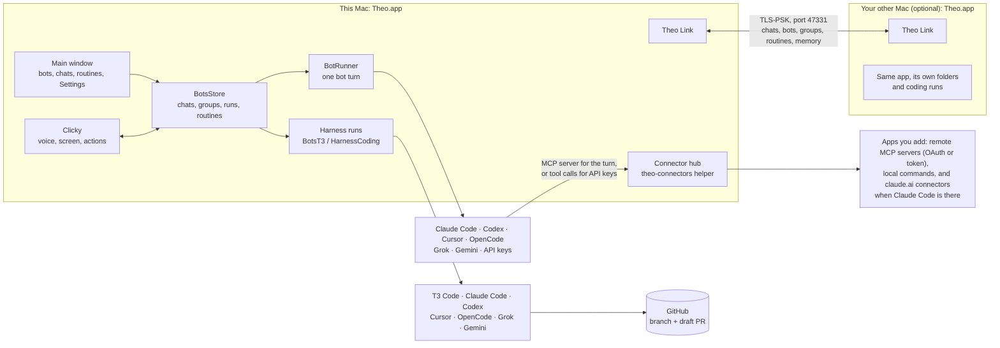

# How Theo is built

This is a map of Theo, for anyone who works on it, person or model. It covers what the parts are, where each one lives, how a message moves through the app, and which repositories make up the project. `AGENTS.md` has the file-by-file detail and the coding rules. When this map and the code disagree, the code is right, so fix this page.

Last checked against the code on 14 Nov 2026 (branch `integration/any-user-all`, the theo-fix-plan packages together).

## In one paragraph

Theo is a native macOS app (`/Applications/Theo.app`, bundle `com.personal.clicky`, executable `Clicky`). It has two halves.

- **Bots:** a harness for building and running bots. Each bot is a persona that answers on a brain: Claude Code, Codex, Cursor, OpenCode, Grok, Gemini, or an API key. None of them is required: Setup asks only that one brain works, and pasting one API key is enough. Bots can message each other privately, talk in group chats, run routines on a schedule, and hand coding work to a coding harness (T3 Code, Claude Code, Codex, Cursor, OpenCode, Grok, Gemini), which commits, pushes and opens a draft PR.
- **Clicky:** a voice and screen companion. It hears you (push-to-talk, wake word, calls, dictation), sees your screen, points and marks on it, does small actions, and runs research on Chrome windows.

Theo works on any Mac. Two Macs of any kind can run the same app and keep each other in step over **Theo Link**. Apps (connectors) belong to Theo's own **connector hub**, not to Claude Code. Nothing goes through a server of ours: brains run on your own subscriptions and keys, and keys and sign-ins stay in the Keychain.

The same engine for Windows and Linux lives in `crossplatform/` (Rust, `theod` plus a Tauri app). It shares the connector hub with the Mac.

## The big picture



## The parts

| Part | Where | What it does |
|---|---|---|
| App start, profiles | `leanring-buddy/TheoApp.swift`, `TheoProfile.swift` | Starts the app, picks the profile (real or `--profile test-x`), writes `~/Library/Logs/Clicky/theo.log` |
| Bots | `leanring-buddy/Bots/` | `BotsStore` holds every bot, chat, group, run and routine and saves them. `BotRunner` runs one turn on an engine. `BotsView` and the cards are the UI |
| Bot rules | `Packages/ClickyCore/Sources/ClickyCore/Team/` | Everything a bot is told, so prompts can be unit-tested: `BotProtocol` (how to write, `[TELL:]`, `@Name`, group turns), `BotAwareness` ("where you are", "who you are"), `ConnectorClaims`. `HarnessGuide` assembles the same texts into the guide every bot can read (`Bots/memory/HARNESS-GUIDE.md`, written at launch; a copy is in `docs/BOT-HARNESS-GUIDE.md`, and a test fails if the copy falls behind) |
| Private messages | `Bots/BotPrivateMessages.swift` | A thread per pair (`dm:<a>+<b>`), its own chat file, synced. In the chat you see one line, and a click opens it |
| Group chats | `BotsStore` (`startRound`, `take`, `groupTurn`), ClickyCore `GroupTurnPlan` | The head reads first and hands out turns by name. Members answer one at a time, each reading the others. One wrap-up from the head |
| Routines | `Bots/BotRoutines.swift`, `BotRoutineSync` | Scheduled instructions to a bot. The same list on both Macs, firing on exactly one (the one you pick in Settings › Devices, else the always-on Mac: a desktop over a laptop, then the smaller id), at most once per slot |
| Connector hub | `crossplatform/crates/theo-connectors` (helper in `Theo.app/Contents/Helpers`), `Bots/ConnectorHub.swift`, ClickyCore `Team/ConnectorHubRules.swift`, `crossplatform/docs/CONNECTORS.md` | Theo's own list of apps, their sign-ins (OAuth with PKCE, or a token), and the read / read-and-draft / full rule per bot and app. Each turn gets a ticket naming only that bot's apps; every brain reaches them through the hub. A claude.ai connector stays reachable as a `claude-account` app when Claude Code is installed |
| Coding runs | `Bots/BotsT3.swift`, `Harness/HarnessCoding.swift`, `Bots/RunChoices.swift` | The card under a final prompt picks the harness, the Mac, the folder (or New folder…) and the chat (new, or continue one). Runs carry their Mac (`T3Run.origin`) |
| Harnesses | `Harness/HarnessCatalog.swift`, `HarnessChats.swift`, `HarnessViews.swift` | Finds each CLI, checks the sign-in, lists a folder's earlier chats from each harness's own files, and shows the Settings cards |
| Providers and keys | `leanring-buddy/Providers/` | 19 providers plus custom ones. Keys in the Keychain (`com.theo.providers`). `APIChat` streams Anthropic and OpenAI-style APIs, with tool calling for bots (`APIChatTools`: its memory folder and its connector hub apps). Sarvam does voice |
| Two Macs | `Link/TheoLink.swift`, ClickyCore `Link/` (`TheoLinkCore`, `DeviceRouting`) | Pairing, sync and catch-up, the waiting queue (`LinkWaitingRequest`), and which Mac does what (Settings › Devices) |
| Clicky | `CompanionManager.swift`, `Voice/`, `Call/`, `Dictation/`, `Actions/`, `Article/`, `Marks/`, `Research/` | Voice in and out, the screen, pointing, actions with safety tiers, article highlights, research agents |
| Hidden screens | `leanring-buddy/Studio/` | Hidden virtual screens on any Mac that can make one, experimental and off by default, on one Mac of a linked pair. Only research Chrome windows go there, never terminals or coding |
| Control inbox | `T3/ClaudiaControlInbox.swift`, `Diagnostics/TheoUIDriver.swift` | JSON commands in `~/.clicky/control-inbox`. `ui*` commands only work in a test profile |
| MCP server | `T3/ClaudiaMCPServer.swift` (`Clicky --mcp`) | Theo's tools for Claude Code, T3 Code and bots: research, see screen, say, notes, app |
| Design | `Theme/`, ClickyCore `TheoPalette`, `docs/DESIGN.md` | Tokens and shared components. `TheoFirstClick` makes every view take the first click |

## What happens when you message a bot

1. You type in a bot's chat. `BotsStore.send` saves your message and decides where the turn runs (`DeviceRouting.botTurn`). By default that's this Mac. If you set bots to the other Mac and it's away, the chat says so straight away and offers to run it here.
2. The prompt is assembled: a "where you are" block (which Mac, what's reachable), a "who you are" block (role, who it reports to), the house style, how to reach others (`[TELL: name: message]`), and the new messages.
3. `BotRunner.run` calls the bot's brain: `claude -p` with the bot's model and a short list of allowed tools (read, web, its memory folder, its apps, never shell), Codex, Cursor, OpenCode, Grok or Gemini, or an API key with tool calls. Its apps come from the connector hub for that turn only. The engine session is resumed per bot. If the brain keeps failing, the stand-in is the fallback brain you chose, and Claude only when it's installed and signed in.
4. The reply is read for tags:
   - `[TELL:]` starts a private exchange, shown as one line that opens on click.
   - A ` ```prompt ` block becomes a run card.
   - A ` ```routine ` block becomes a routine.
   - `[CHOOSE:]` becomes a call card.
   - `[CLICKY:]` from Theo becomes a Clicky turn.
5. If a reply says an app is "disconnected", the turn gets one more try 20 s later, on any brain. An app still loading at the start of a turn looks gone.

## Coding runs

A run starts from your own words or from Start on a run card, never from a bot alone. It goes to the harness on the chosen Mac, in a worktree when the folder is a repo with a remote, and it finishes with a commit, a push and a draft PR. Without a remote, the change is made in place. Follow-ups typed on the card land on the same branch. Each new run keeps its own chat (`HarnessChatGate`). "Continue" picks an earlier chat of that folder, by id. A run queued for the other Mac that waited more than 10 minutes waits for your Start, and after a day it's dropped.

## Two Macs

- **Link:** TLS with a shared secret in `~/.clicky/link-secret`, Bonjour `_theolink._tcp`, port 47331.
- **What syncs:**
  - bots, groups, layout, chats and private threads
  - routines, delegations, Clicky's memory, bot memory (by line union)
  - edits are merged by newest change stamp (`link-stamps.json`)
- **What never syncs:** API keys, engine sessions, `~/Clicky Notes` files.
- **Who does what:** Settings › Devices. There are no kinds of Mac: each one is "this Mac" or "the other Mac", known by its id and real name. Theo works on the Mac you're using, and routines fire on exactly one Mac. Clicky, dictation and voice run anywhere. Hidden screens are on one Mac at most.
- **Updates:** `updateWhenIdle` asks the other Mac to install the normal update when it's idle.

## Data on disk

| What | Where |
|---|---|
| Bots, chats, groups, routines, runs | `~/Library/Application Support/Theo/Bots/` (`bots.json`, `chats/*.json`, `groups.json`, `routines.json`, `t3runs.json`, `link-stamps.json`) |
| Bot memory, and the folder bots run in | `~/Library/Application Support/Theo/Bots/memory/<bot>/memory.md` |
| Run worktrees | `~/Library/Application Support/Theo/worktrees/` |
| Settings | `defaults` domain `com.personal.clicky` (a test profile is `com.personal.clicky.test-x`) |
| Keys | Keychain service `com.theo.providers` |
| Apps (connectors) | `~/Library/Application Support/Theo/Connectors/` (the list; sign-ins encrypted, their key in the Keychain under `com.theo.connectors`; per-turn tickets in `tickets/`) |
| Log | `~/Library/Logs/Clicky/theo.log` |
| Test profiles | `~/Library/Application Support/Theo-Test-<name>/home` |

Nothing in Theo writes under `~/.t3`: that's T3 Code's folder.

## Repositories, and the original developer's Macs

Nothing here is needed to build or use Theo: it records where the original developer keeps things. A new contributor needs only `adhyanmahajan26-boop/clicky`. "Working copy" says where it is on the developer's Macs. Check that they're right; anything marked "check" I couldn't confirm from the Studio.

| Repository | What it is | Working copy | Branch in use |
|---|---|---|---|
| `adhyanmahajan26-boop/clicky` (private) | Theo itself: the app, ClickyCore, tests, docs | Studio: `~/Projects/clicky-ui-crew`, plus worktrees `~/Projects/clicky` (theo-round3) and `~/Projects/clicky-decider` (theo-decider, PR #1) | `theo-ui-crew` is what's installed. `theo-verify-1109` has the 9 Nov fixes |
| `adhyanmahajan26-boop/claudia-releases` (private) | Built and signed Theo zips. Update now installs from here | none, releases only | latest published: `build-202611051828` |
| `adhyanmahajan26-boop/t3code` (private) | Your T3 Code fork: `t3 thread start --effort`, `t3 thread stop`, the bots app | Studio: `~/Projects/claudia-t3code` (remote `fork`; `origin` is pingdotgg/t3code upstream) | `theo-bots-app` (5ba12f83, the `thread stop` commit isn't pushed) |
| `adhyanmahajan26-boop/claudia-t3-plugin` (private) | Theo's plugin for T3 Code | Studio: `~/Projects/claudia-t3-plugin` | `main` |
| `adhyanmahajan26-boop/theo-pr-sandbox` (private) | Where tests open draft PRs | none needed | draft PRs #1 to #14 from tests |
| MacBook Air | Stock T3 Code, and Theo installed from claudia-releases | check: the Air was closed on 9 Nov | check |

New projects go in the projects folder you set (Settings › Harnesses, default `~/Projects`). On the original developer's Studio, folders that coding runs made in `~/Projects` mostly have no remote (black-hole-*, moon-phases-page, tip-calculator, zz-link-test*). The ones with a remote are `falaknama` and `partatlas`.

## Testing and releases

- Unit tests: `cd Packages/ClickyCore && swift test` (1,259 tests on 9 Nov).
- App tests: `xcodebuild test -scheme leanring-buddy`.
- Live checks run in a test profile (`docs/TESTING.md`, `Tools/theoui.py`), on cheap models, and never in your real profile. The real app answers read-only commands only (`botsState`, `harnessState`, `routines`).
- Release: `Tools/release.sh` builds, signs (Apple Development, so permissions survive), zips and publishes to claudia-releases. `CLICKY_RELEASE_DRY_RUN=1` stages without publishing. Back up `/Applications/Theo.app` before an install, and install only when nothing's playing.

## Known gaps on the developer's Macs (9 Nov)

- Bots can't run commands, so a bot can't make a PDF itself.
- Messages caught up from the other Mac show the time they arrived, not the time you typed them.
- The Air is on an older build.
- Gemini isn't signed in. The only saved key is Sarvam.
